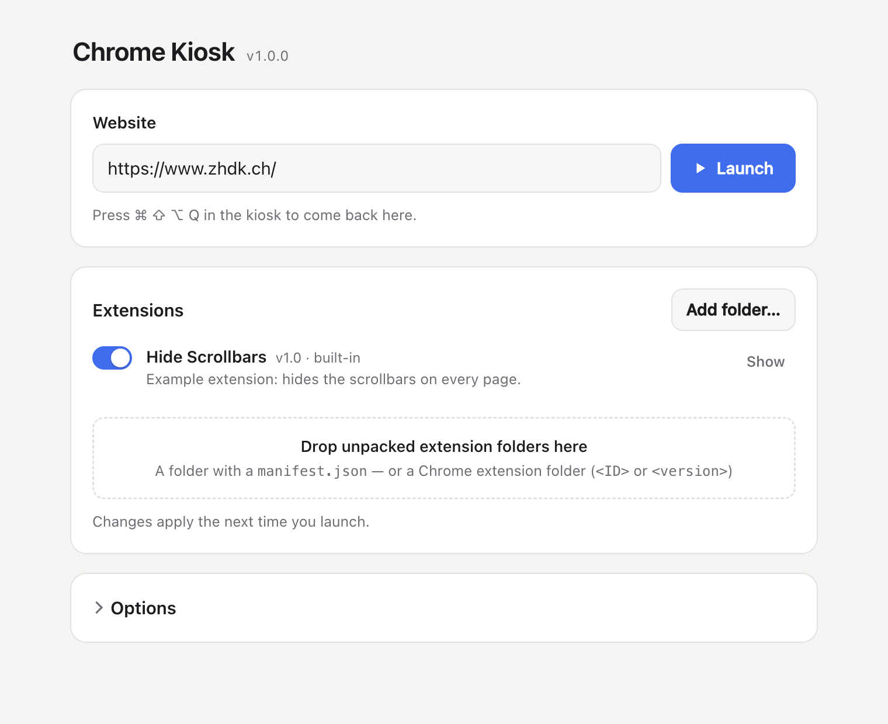

# Electron: Chrome Kiosk

[Deutsch](README_DE.md)



Opens any website fullscreen in kiosk mode — no address bar, no menus, no
shortcuts. Visitors cannot leave the page, reload it, open the developer
tools or quit the app. For installations, exhibitions and public terminals.

A launcher window lets you type in the URL, add Chrome extensions by
dragging their folders in, switch them on and off, and set the kiosk
options. Ready-made builds for macOS, Windows and Linux run without Node.js
or VS Code.

Based on [Electron_P5_Starter](https://github.com/ZHdK-Critical-Coding/Electron_P5_Starter).

## Installation

Requirements: [Node.js](https://nodejs.org/) (LTS) and
[Visual Studio Code](https://code.visualstudio.com/).

1. Open the folder in Visual Studio Code.
2. Open a terminal (`Terminal → New Terminal`) and install the dependencies
   (only needed once):
   ```sh
   npm install
   ```
3. Start the app:
   ```sh
   npm start
   ```
4. In the launcher, type the website's address and click **Launch**.
5. **To leave the kiosk, press `Cmd` + `Shift` + `Alt` + `Q` (macOS) or
   `Ctrl` + `Shift` + `Alt` + `Q` (Windows/Linux).** This brings you back to
   the launcher. Close the launcher to quit the app.

Dependencies (`package.json`): Electron 45 (Chromium 156), electron-builder
26. The first start downloads Electron (~100 MB).

## Using the Launcher

- **Website:** type an address and press `Enter` or click **Launch**.
  `example.com` becomes `https://example.com`, `localhost:3000` becomes
  `http://localhost:3000`, and a path like `/Users/me/show/index.html`
  opens that local file.
- **Extensions:** drag extension folders onto the dashed area or click
  **Add folder…**. The switch turns an extension on or off, **Show** opens
  its folder, **Remove** deletes it. Changes apply the next time you
  launch. If an extension cannot be loaded, the error appears below it.
  See [Chrome Extensions](#chrome-extensions).
- **Options:**

  | Option                                       | Meaning                                                              |
  | -------------------------------------------- | -------------------------------------------------------------------- |
  | Start the kiosk right away when the app opens | Skip the launcher — for unattended installations (see below)        |
  | Open the app when the user logs in           | Autostart, built app on macOS and Windows                            |
  | Hide the mouse pointer                       | For touch screens or displays without interaction                    |
  | Stay on this website                         | Links to other domains are ignored                                   |
  | Allow camera, microphone, location …         | Pages get these permissions without asking                           |
  | Delete cookies, logins and cache             | Fresh start on every launch, e.g. for public terminals               |
  | Back to start page after … seconds idle      | Reload the start page after a time without input. `0` = never        |
  | Zoom                                         | Page zoom in percent                                                 |

Everything is saved automatically and still there after a restart. The
settings are stored in the app's user data folder (`settings.json`, with
the added extensions in `extensions/` next to it):

- macOS: `~/Library/Application Support/<app name>/`
- Windows: `%APPDATA%\<app name>\`
- Linux: `~/.config/<app name>/`

`<app name>` is `electron-chrome-kiosk` with `npm start` and
`Electron Chrome Kiosk` for the built app. Delete the folder to start over.

### Unattended Installations

Turn on **Start the kiosk right away when the app opens** (and, for the
built app, **Open the app when the user logs in**). From then on the app
goes straight into the kiosk. The exit shortcut brings up the launcher, so
you can still change things on site.

## How to Run

| Command                                  | What it does                                                          |
| ---------------------------------------- | --------------------------------------------------------------------- |
| `npm start`                              | Launcher, then the real kiosk: fullscreen, all shortcuts blocked      |
| `npm run dev`                            | Kiosk opens in a window with dev tools, shortcuts work, `Escape` exits |
| `npm start -- --url=https://example.com` | Prefill the URL                                                       |
| `npm start -- --kiosk`                   | Skip the launcher and start the kiosk directly                        |

In dev mode, the app restarts by itself when you save `config.js` or
`main.js`, and the launcher reloads when you save a file in `launcher/`.

## config.js

`config.js` holds the settings that are not in the launcher, and the
default values for the very first start:

| Setting             | Default                          | Meaning                                                                       |
| ------------------- | -------------------------------- | ----------------------------------------------------------------------------- |
| `url`               | `'https://www.zhdk.ch'`          | URL on the first start                                                        |
| `exitShortcut`      | `'CommandOrControl+Shift+Alt+Q'` | The only key combination that works in the kiosk: back to the launcher. `null` = no way out |
| `retryAfterSeconds` | `10`                             | Reload after this many seconds if the page could not be loaded                |
| all others          |                                  | Defaults for the launcher options                                             |

`exitShortcut` uses Electron's
[accelerator syntax](https://www.electronjs.org/docs/latest/api/accelerator),
e.g. `'Control+Alt+X'` or `'CommandOrControl+Shift+F12'`. Choose a
combination visitors will not press by accident.

## Chrome Extensions

Unpacked Chrome extensions can be added in the launcher. They are copied
into the user data folder, so the original can be moved or deleted.
Adding the same extension again updates it.

**Using an extension you have installed in Chrome:**

1. In Chrome, open `chrome://extensions`, turn on *Developer mode* and note
   the extension's ID.
2. Find its folder:
   - macOS: `~/Library/Application Support/Google/Chrome/Default/Extensions/<ID>/`
   - Windows: `%LOCALAPPDATA%\Google\Chrome\User Data\Default\Extensions\<ID>\`
   - Linux: `~/.config/google-chrome/Default/Extensions/<ID>/`
   (On macOS, press `Cmd` + `Shift` + `G` in the Finder and paste the path.)
3. Drag the `<ID>` folder onto the launcher. The newest version inside is
   used, and Chrome's `_metadata` folder is removed.

**Built-in extensions:** extension folders in the project's `extensions/`
folder are part of the app and show up as *built-in*. They can be switched
off, but not removed in the launcher. The included example
`extensions/hide-scrollbars` hides all scrollbars. Folders starting with
`_` are off until switched on.

**Writing your own:** a folder with a `manifest.json` and a
[content script](https://developer.chrome.com/docs/extensions/develop/concepts/content-scripts)
is enough — see the example. A content script can change the CSS of the
page, hide elements or add JavaScript to any website.

**Limits:** Electron only supports
[part of the Chrome extension APIs](https://www.electronjs.org/docs/latest/api/extensions).
Content scripts, `chrome.storage`, `chrome.runtime` messaging and
background service workers work. There is no toolbar, so extension
buttons and popups cannot be opened, and extensions that need e.g.
`chrome.tabs`, `chrome.webRequest` blocking or `declarativeNetRequest` may
not work fully. Try each extension with `npm run dev`; the developer tools
show its errors.

## What Is Blocked in the Kiosk

- **Shortcuts:** every key combination with `Cmd`, `Ctrl` or `Alt`, all
  function keys (`F1`–`F24`) and the browser keys on some keyboards. So no
  reload, back, zoom, print, save, new window, dev tools, quit or close.
  Normal typing (letters, numbers, `Shift`, `Enter`, arrows, `Escape`)
  still reaches the page, so forms and keyboard-controlled pages work.
- **Window:** kiosk fullscreen, always on top, cannot be closed
  (`Alt`+`F4` is ignored). On macOS, the Dock, the menu bar, `Cmd`+`Tab`
  and force quit (`Cmd`+`Alt`+`Esc`) are disabled.
- **Browser:** no address bar, no menu, no context menu, no pinch zoom.
  Links that open a new window open in the kiosk window.
- **Robustness:** the page is reloaded if it cannot be loaded (no network
  yet after booting) or crashes. Only one instance can run. The display is
  kept from going to sleep.

**What cannot be blocked by an app:** system key combinations such as
`Ctrl`+`Alt`+`Del` and the `Windows` key on Windows, or the power button.
For a fully locked-down computer, also use the operating system's kiosk
features (Windows: *Assigned Access*; macOS: a separate user account with
restrictions) and disable gestures and hot corners.

## Chromium Version

The kiosk does not use the Chrome installed on the computer. Electron
brings its own Chromium — the same engine (Blink, V8, GPU acceleration)
as Google Chrome, so pages run just as fast. Each Electron version is tied
to one Chromium version and usually a few weeks behind Chrome. Check which
one you have:

```sh
npx electron -p "process.versions.chrome"
```

**Updating:** install the newest Electron, test with `npm run dev`, then
rebuild:

```sh
npm install --save-dev electron@latest
```

Built apps do not update themselves — rebuild and reinstall them from time
to time, also for security updates. On GitHub, Dependabot
(`.github/dependabot.yml`) checks every week and opens a pull request when
a new Electron version is out; the Build workflow builds it for testing.

**Differences from Google Chrome:** no Widevine DRM, so streaming services
like Netflix or Spotify do not play. No Chrome sync, no Google account
login in the browser, and only part of the extension APIs (see above).

## Building the App

A build turns the project into a standalone app. `config.js` and the
`extensions/` folder are built into the app. All results are saved in
`dist/`.

| Command               | Result                                                                        |
| --------------------- | ----------------------------------------------------------------------------- |
| `npm run pack`        | Quick test build for your own computer, no installer                          |
| `npm run build`       | Build for the computer you are working on                                     |
| `npm run build:mac`   | macOS: `.dmg` and `.zip` (runs on Apple Silicon and Intel)                    |
| `npm run build:mac:notarized` | macOS, signed and notarized (see below)                               |
| `npm run build:win`   | Windows: installer (`Setup.exe`) and `portable.exe` (runs without installing) |
| `npm run build:linux` | Linux: `.AppImage`                                                            |
| `npm run build:all`   | All of the above                                                              |

All platforms can be built from a Mac. The first build takes a while,
because the needed tools are downloaded.

- **Name and version:** change `productName` in the `build` section and
  `version` in `package.json`. Both appear in the file names of the build.
- **App icon:** create a folder `build/` with a square `icon.png` (at least
  1024 × 1024 px). Without it, the default Electron icon is used.
- **Command line:** the built app accepts `--url=…` and `--kiosk` too,
  e.g. on macOS
  `open -a "Electron Chrome Kiosk" --args --kiosk --url=https://example.com`.
- **Opening the app on another computer:** unless notarized (see below),
  the builds are not signed, so the system warns the first time. macOS: right-click the app → *Open* →
  *Open*; if macOS says the app is "damaged", run
  `xattr -cr "/Applications/Electron Chrome Kiosk.app"`. Windows: in the
  SmartScreen dialog, click *More info* → *Run anyway*. Linux:
  `chmod +x *.AppImage`.

### Signing and Notarizing (macOS)

A notarized app opens on every Mac without warnings. You need a paid
[Apple Developer](https://developer.apple.com/programs/) membership.

**One-time setup:**

1. Install a **Developer ID Application** certificate: Xcode → *Settings*
   → *Accounts* → *Manage Certificates* → `+`, or at
   [developer.apple.com](https://developer.apple.com/account/resources/certificates).
   Check with `security find-identity -v -p codesigning`.
2. Create an app-specific password at [account.apple.com](https://account.apple.com)
   → *Sign-In and Security* → *App-Specific Passwords*.
3. Store the notary credentials in the keychain (asks for the
   app-specific password; the team ID is in brackets after your name in
   step 1):
   ```sh
   xcrun notarytool store-credentials kiosk-notary --apple-id YOUR_APPLE_ID --team-id YOUR_TEAM_ID
   ```
   If `xcrun` complains about the Xcode license, either run
   `sudo xcodebuild -license accept` or put
   `DEVELOPER_DIR=/Library/Developer/CommandLineTools` in front of the
   command.

**Building:**

```sh
npm run build:mac:notarized
```

`scripts/build-mac-notarized.sh` checks the setup, builds the app for
Apple Silicon and Intel, signs it, has the app and the `.dmg` notarized by
Apple (usually 2–15 minutes), and checks the result. The finished `.dmg`
and `.zip` are in `dist/`.

The signing settings are in `package.json` (`build.mac`: hardened runtime,
entitlements, texts for the camera and microphone permission dialogs) and
`build/entitlements.mac.plist`. `npm run build:mac` also signs when a
certificate is found, but does not notarize. The GitHub build stays
unsigned.

### Building on GitHub

`.github/workflows/build.yml` builds the app for all three platforms on
GitHub's computers — nothing needs to be installed locally.

- Every push to `main`: the apps can be downloaded under *Actions* → the
  latest *Build* run → *Artifacts*.
- Publish a release: change `version` in `package.json`, commit, then
  ```sh
  git tag v1.0.0
  git push --tags
  ```
  After a few minutes the Windows and Linux apps appear under *Releases*.
  The macOS app on GitHub would not be signed, so it is left out. Build
  the notarized one locally and add it to the same release:
  ```sh
  npm run build:mac:notarized
  gh release upload v1.0.0 dist/*.dmg dist/*.zip
  ```
- Start a build by hand: *Actions* → *Build* → *Run workflow*.

## Setting Up a Kiosk Computer

1. Build the app (`npm run build:mac` / `build:win`) and install it on the
   kiosk computer.
2. Open it, enter the URL, add the extensions and launch once to check
   everything. Leave the kiosk with the exit shortcut.
3. Under *Options*, turn on **Start the kiosk right away** and **Open the
   app when the user logs in** (or add the app to the login items yourself:
   macOS: *System Settings → General → Login Items*; Windows: put a
   shortcut in `shell:startup`).
4. Turn on automatic login for the user account and turn off sleep, screen
   saver and system updates during opening hours.
5. If the page uses camera or microphone: confirm the macOS permission
   dialog the first time (*System Settings → Privacy & Security*).
6. Restart the computer and check that the page comes up by itself.

## Coding Help

### Project Structure

```
Electron_Chrome_Kiosk/
├── .github/            # Build on GitHub (workflows/build.yml), update checks (dependabot.yml)
├── build/              # macOS entitlements, (optional) icon.png
├── scripts/            # build-mac-notarized.sh
├── dist/               # Built apps end up here
├── extensions/         # Built-in Chrome extensions, one folder each
│   └── hide-scrollbars/
├── launcher/           # The launcher window
│   ├── index.html
│   ├── launcher.css
│   ├── launcher.js     # UI logic
│   └── preload.js      # Connects the page with main.js
├── config.js           # Exit shortcut and default settings
├── main.js             # Electron main process (settings, extensions, kiosk)
└── package.json        # Scripts and build configuration
```

### What Happens Where

- **`main.js` → Settings**: `loadSettings()` / `saveSettings()` read and
  write `settings.json`; `config.js` provides the defaults.
- **`main.js` → Extensions**: `listExtensions()` collects the built-in and
  added extensions, `addExtension()` copies a dropped folder and test-loads
  it, `loadKioskExtensions()` loads the enabled ones before the kiosk opens.
- **`main.js` → `handleKioskKeys()`**: runs for every key press in the kiosk
  before the page sees it. Returns to the launcher on `exitShortcut`,
  otherwise drops all combinations with `Cmd`/`Ctrl`/`Alt` and the
  function keys (`event.preventDefault()`).
- **`main.js` → `launchKiosk()` / `exitKiosk()`**: open the kiosk window
  (removes the app menu and with it all menu shortcuts, loads extensions,
  installs the handlers for navigation, load errors, crashes and closing,
  keeps the display awake) and close it again.
- **`main.js` → `registerIpc()`**: everything the launcher can ask
  `main.js` to do. `launcher/preload.js` makes these available to the page
  as `window.kiosk`.
- **`launcher/launcher.js`**: renders the settings and extension list and
  handles drag and drop.
- **`package.json` → `build`**: electron-builder settings (app id, product
  name, which files go into the app, targets per platform).
