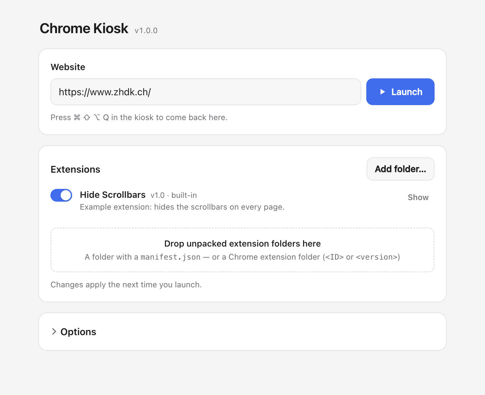

# Electron: Chrome Kiosk

[English](README.md)



Öffnet eine beliebige Website im Vollbild-Kioskmodus – ohne Adressleiste,
ohne Menüs, ohne Tastenkürzel. Besucher:innen können die Seite nicht
verlassen, nicht neu laden, keine Entwicklertools öffnen und die App nicht
beenden. Für Installationen, Ausstellungen und öffentliche Terminals.

In einem Startfenster wird die URL eingegeben, Chrome-Erweiterungen werden
per Drag & Drop hinzugefügt und ein- oder ausgeschaltet, und die
Kiosk-Optionen werden eingestellt. Fertige Builds für macOS, Windows und
Linux laufen ohne Node.js oder VS Code.

Basiert auf [Electron_P5_Starter](https://github.com/ZHdK-Critical-Coding/Electron_P5_Starter).

## Installation

Voraussetzungen: [Node.js](https://nodejs.org/) (LTS) und
[Visual Studio Code](https://code.visualstudio.com/).

1. Den Ordner in Visual Studio Code öffnen.
2. Ein Terminal öffnen (`Terminal → New Terminal`) und die Abhängigkeiten
   installieren (nur einmal nötig):
   ```sh
   npm install
   ```
3. Die App starten:
   ```sh
   npm start
   ```
4. Im Startfenster die Adresse der Website eingeben und auf **Launch**
   klicken.
5. **Den Kiosk verlassen mit `Cmd` + `Shift` + `Alt` + `Q` (macOS) bzw.
   `Ctrl` + `Shift` + `Alt` + `Q` (Windows/Linux).** Das führt zurück zum
   Startfenster. Wird das Startfenster geschlossen, beendet sich die App.

Abhängigkeiten (`package.json`): Electron 45 (Chromium 156),
electron-builder 26. Beim ersten Start wird Electron heruntergeladen
(~100 MB).

## Das Startfenster

- **Website:** Adresse eingeben und `Enter` drücken oder auf **Launch**
  klicken. Aus `example.com` wird `https://example.com`, aus
  `localhost:3000` wird `http://localhost:3000`, und ein Pfad wie
  `/Users/me/show/index.html` öffnet die lokale Datei.
- **Erweiterungen:** Erweiterungsordner auf die gestrichelte Fläche ziehen
  oder auf **Add folder…** klicken. Der Schalter schaltet eine Erweiterung
  ein oder aus, **Show** öffnet ihren Ordner, **Remove** löscht sie.
  Änderungen gelten beim nächsten Start des Kiosks. Kann eine Erweiterung
  nicht geladen werden, steht der Fehler darunter. Siehe
  [Chrome-Erweiterungen](#chrome-erweiterungen).
- **Optionen:**

  | Option                                        | Bedeutung                                                           |
  | --------------------------------------------- | ------------------------------------------------------------------- |
  | Start the kiosk right away when the app opens | Startfenster überspringen – für unbeaufsichtigte Installationen (siehe unten) |
  | Open the app when the user logs in            | Autostart, gebaute App unter macOS und Windows                      |
  | Hide the mouse pointer                        | Für Touchscreens oder Bildschirme ohne Interaktion                  |
  | Stay on this website                          | Links auf andere Domains werden ignoriert                           |
  | Allow camera, microphone, location …          | Seiten erhalten diese Berechtigungen ohne Nachfrage                 |
  | Delete cookies, logins and cache              | Bei jedem Start frisch, z. B. für öffentliche Terminals             |
  | Back to start page after … seconds idle       | Startseite nach einer Zeit ohne Eingabe neu laden. `0` = nie        |
  | Zoom                                          | Seitenzoom in Prozent                                               |

Alles wird automatisch gespeichert und bleibt nach einem Neustart
erhalten. Die Einstellungen liegen im Benutzerdaten-Ordner der App
(`settings.json`, die hinzugefügten Erweiterungen daneben in
`extensions/`):

- macOS: `~/Library/Application Support/<App-Name>/`
- Windows: `%APPDATA%\<App-Name>\`
- Linux: `~/.config/<App-Name>/`

`<App-Name>` ist `electron-chrome-kiosk` mit `npm start` und
`Electron Chrome Kiosk` bei der gebauten App. Ordner löschen, um von vorne
zu beginnen.

### Unbeaufsichtigte Installationen

**Start the kiosk right away when the app opens** einschalten (und bei der
gebauten App **Open the app when the user logs in**). Ab dann startet die
App direkt im Kiosk. Das Exit-Tastenkürzel öffnet das Startfenster, so
lässt sich vor Ort weiterhin alles ändern.

## Ausführen

| Befehl                                   | Was passiert                                                              |
| ---------------------------------------- | ------------------------------------------------------------------------- |
| `npm start`                              | Startfenster, dann der echte Kiosk: Vollbild, alle Tastenkürzel gesperrt  |
| `npm run dev`                            | Kiosk im Fenster mit Entwicklertools, Tastenkürzel aktiv, `Escape` beendet |
| `npm start -- --url=https://example.com` | URL vorausfüllen                                                          |
| `npm start -- --kiosk`                   | Startfenster überspringen und direkt den Kiosk starten                    |

Im Entwicklungsmodus startet die App von selbst neu, wenn `config.js` oder
`main.js` gespeichert wird, und das Startfenster lädt neu, wenn eine Datei
in `launcher/` gespeichert wird.

## config.js

`config.js` enthält die Einstellungen, die nicht im Startfenster sind,
sowie die Standardwerte für den allerersten Start:

| Einstellung         | Standard                         | Bedeutung                                                                       |
| ------------------- | -------------------------------- | ------------------------------------------------------------------------------- |
| `url`               | `'https://www.zhdk.ch'`          | URL beim ersten Start                                                           |
| `exitShortcut`      | `'CommandOrControl+Shift+Alt+Q'` | Einzige funktionierende Tastenkombination im Kiosk: zurück zum Startfenster. `null` = kein Ausweg |
| `retryAfterSeconds` | `10`                             | Neu laden nach so vielen Sekunden, wenn die Seite nicht geladen werden konnte   |
| alle anderen        |                                  | Standardwerte für die Optionen im Startfenster                                  |

`exitShortcut` verwendet die
[Accelerator-Syntax](https://www.electronjs.org/docs/latest/api/accelerator)
von Electron, z. B. `'Control+Alt+X'` oder `'CommandOrControl+Shift+F12'`.
Eine Kombination wählen, die niemand aus Versehen drückt.

## Chrome-Erweiterungen

Entpackte Chrome-Erweiterungen werden im Startfenster hinzugefügt. Sie
werden in den Benutzerdaten-Ordner kopiert, das Original kann also
verschoben oder gelöscht werden. Wird dieselbe Erweiterung nochmals
hinzugefügt, wird sie aktualisiert.

**Eine in Chrome installierte Erweiterung verwenden:**

1. In Chrome `chrome://extensions` öffnen, den *Entwicklermodus*
   einschalten und die ID der Erweiterung notieren.
2. Ihren Ordner suchen:
   - macOS: `~/Library/Application Support/Google/Chrome/Default/Extensions/<ID>/`
   - Windows: `%LOCALAPPDATA%\Google\Chrome\User Data\Default\Extensions\<ID>\`
   - Linux: `~/.config/google-chrome/Default/Extensions/<ID>/`
   (Unter macOS im Finder `Cmd` + `Shift` + `G` drücken und den Pfad
   einfügen.)
3. Den `<ID>`-Ordner auf das Startfenster ziehen. Die neueste Version darin
   wird verwendet, und Chromes `_metadata`-Ordner wird entfernt.

**Eingebaute Erweiterungen:** Erweiterungsordner im Projektordner
`extensions/` sind Teil der App und erscheinen als *built-in*. Sie lassen
sich ausschalten, aber im Startfenster nicht entfernen. Das mitgelieferte
Beispiel `extensions/hide-scrollbars` blendet alle Scrollbalken aus.
Ordner, die mit `_` beginnen, sind ausgeschaltet, bis sie eingeschaltet
werden.

**Eigene Erweiterung schreiben:** Ein Ordner mit `manifest.json` und einem
[Content Script](https://developer.chrome.com/docs/extensions/develop/concepts/content-scripts)
genügt – siehe Beispiel. Ein Content Script kann das CSS der Seite ändern,
Elemente ausblenden oder JavaScript in jede Website einfügen.

**Einschränkungen:** Electron unterstützt nur
[einen Teil der Chrome-Extension-APIs](https://www.electronjs.org/docs/latest/api/extensions).
Content Scripts, `chrome.storage`, `chrome.runtime`-Messaging und
Background Service Worker funktionieren. Es gibt keine Symbolleiste, daher
lassen sich Erweiterungs-Buttons und Popups nicht öffnen, und
Erweiterungen, die z. B. `chrome.tabs`, blockierendes `chrome.webRequest`
oder `declarativeNetRequest` brauchen, funktionieren evtl. nur teilweise.
Jede Erweiterung mit `npm run dev` ausprobieren; die Entwicklertools zeigen
ihre Fehler.

## Was im Kiosk gesperrt ist

- **Tastenkürzel:** jede Tastenkombination mit `Cmd`, `Ctrl` oder `Alt`,
  alle Funktionstasten (`F1`–`F24`) und die Browser-Tasten mancher
  Tastaturen. Also kein Neuladen, Zurück, Zoomen, Drucken, Speichern, neues
  Fenster, Entwicklertools, Beenden oder Schliessen. Normales Tippen
  (Buchstaben, Zahlen, `Shift`, `Enter`, Pfeiltasten, `Escape`) kommt
  weiterhin bei der Seite an – Formulare und tastaturgesteuerte Seiten
  funktionieren.
- **Fenster:** Kiosk-Vollbild, immer im Vordergrund, kann nicht geschlossen
  werden (`Alt`+`F4` wird ignoriert). Unter macOS sind Dock, Menüleiste,
  `Cmd`+`Tab` und Sofort beenden (`Cmd`+`Alt`+`Esc`) deaktiviert.
- **Browser:** keine Adressleiste, kein Menü, kein Kontextmenü, kein
  Pinch-Zoom. Links, die ein neues Fenster öffnen würden, öffnen sich im
  Kiosk-Fenster.
- **Robustheit:** Die Seite wird neu geladen, wenn sie nicht geladen werden
  kann (z. B. noch kein Netzwerk nach dem Hochfahren) oder abstürzt. Es
  läuft immer nur eine Instanz. Der Bildschirm geht nicht in den Ruhezustand.

**Was eine App nicht sperren kann:** Systemtasten wie `Ctrl`+`Alt`+`Del`
und die `Windows`-Taste unter Windows oder den Ein-/Aus-Knopf. Für einen
komplett abgeriegelten Computer zusätzlich die Kiosk-Funktionen des
Betriebssystems nutzen (Windows: *Zugewiesener Zugriff*; macOS: eigenes
Benutzerkonto mit Einschränkungen) und Gesten sowie aktive Ecken
ausschalten.

## Chromium-Version

Der Kiosk verwendet nicht das auf dem Computer installierte Chrome.
Electron bringt sein eigenes Chromium mit – dieselbe Engine (Blink, V8,
GPU-Beschleunigung) wie Google Chrome, Seiten laufen also gleich schnell.
Jede Electron-Version gehört zu einer Chromium-Version und liegt meist
einige Wochen hinter Chrome. Die aktuelle Version anzeigen:

```sh
npx electron -p "process.versions.chrome"
```

**Aktualisieren:** das neueste Electron installieren, mit `npm run dev`
testen und neu bauen:

```sh
npm install --save-dev electron@latest
```

Gebaute Apps aktualisieren sich nicht selbst – sie von Zeit zu Zeit neu
bauen und installieren, auch wegen Sicherheitsupdates. Auf GitHub prüft
Dependabot (`.github/dependabot.yml`) jede Woche und öffnet einen Pull
Request, sobald eine neue Electron-Version erscheint; der Build-Workflow
baut sie zum Testen.

**Unterschiede zu Google Chrome:** kein Widevine-DRM, Streamingdienste wie
Netflix oder Spotify spielen also nicht ab. Kein Chrome-Sync, keine
Google-Konto-Anmeldung im Browser und nur ein Teil der Extension-APIs
(siehe oben).

## App bauen

Ein Build macht aus dem Projekt eine eigenständige App. `config.js` und der
Ordner `extensions/` werden in die App eingebaut. Alle Ergebnisse landen in
`dist/`.

| Befehl                | Ergebnis                                                                          |
| --------------------- | --------------------------------------------------------------------------------- |
| `npm run pack`        | Schneller Test-Build für den eigenen Computer, ohne Installer                     |
| `npm run build`       | Build für den Computer, an dem gearbeitet wird                                    |
| `npm run build:mac`   | macOS: `.dmg` und `.zip` (läuft auf Apple Silicon und Intel)                      |
| `npm run build:mac:notarized` | macOS, signiert und notarisiert (siehe unten)                             |
| `npm run build:win`   | Windows: Installer (`Setup.exe`) und `portable.exe` (läuft ohne Installation)     |
| `npm run build:linux` | Linux: `.AppImage`                                                                |
| `npm run build:all`   | Alle oben genannten                                                               |

Alle Plattformen können auf einem Mac gebaut werden. Der erste Build dauert
eine Weile, weil die nötigen Werkzeuge heruntergeladen werden.

- **Name und Version:** `productName` im Abschnitt `build` und `version` in
  `package.json` ändern. Beide erscheinen in den Dateinamen des Builds.
- **App-Icon:** einen Ordner `build/` mit einem quadratischen `icon.png`
  (mindestens 1024 × 1024 px) anlegen. Ohne Icon wird das Electron-Icon
  verwendet.
- **Kommandozeile:** Auch die gebaute App versteht `--url=…` und
  `--kiosk`, z. B. unter macOS
  `open -a "Electron Chrome Kiosk" --args --kiosk --url=https://example.com`.
- **App auf einem anderen Computer öffnen:** Ohne Notarisierung (siehe
  unten) sind die Builds nicht signiert, deshalb warnt das System beim
  ersten Öffnen. macOS: Rechtsklick
  auf die App → *Öffnen* → *Öffnen*; meldet macOS, die App sei
  «beschädigt», `xattr -cr "/Applications/Electron Chrome Kiosk.app"`
  ausführen. Windows: im SmartScreen-Dialog *Weitere Informationen* →
  *Trotzdem ausführen*. Linux: `chmod +x *.AppImage`.

### Signieren und Notarisieren (macOS)

Eine notarisierte App öffnet sich auf jedem Mac ohne Warnung. Dafür
braucht es eine kostenpflichtige
[Apple-Developer](https://developer.apple.com/programs/)-Mitgliedschaft.

**Einmalige Einrichtung:**

1. Ein **Developer ID Application**-Zertifikat installieren: Xcode →
   *Einstellungen* → *Accounts* → *Manage Certificates* → `+`, oder auf
   [developer.apple.com](https://developer.apple.com/account/resources/certificates).
   Prüfen mit `security find-identity -v -p codesigning`.
2. Auf [account.apple.com](https://account.apple.com) → *Anmeldung und
   Sicherheit* → *App-spezifische Passwörter* ein Passwort erstellen.
3. Die Zugangsdaten für die Notarisierung im Schlüsselbund speichern
   (fragt nach dem app-spezifischen Passwort; die Team-ID steht in
   Klammern hinter dem Namen aus Schritt 1):
   ```sh
   xcrun notarytool store-credentials kiosk-notary --apple-id DEINE_APPLE_ID --team-id DEINE_TEAM_ID
   ```
   Beschwert sich `xcrun` über die Xcode-Lizenz, entweder
   `sudo xcodebuild -license accept` ausführen oder
   `DEVELOPER_DIR=/Library/Developer/CommandLineTools` vor den Befehl
   setzen.

**Bauen:**

```sh
npm run build:mac:notarized
```

`scripts/build-mac-notarized.sh` prüft die Einrichtung, baut die App für
Apple Silicon und Intel, signiert sie, lässt App und `.dmg` von Apple
notarisieren (meist 2–15 Minuten) und prüft das Ergebnis. Die fertige
`.dmg` und `.zip` liegen in `dist/`.

Die Signatur-Einstellungen stehen in `package.json` (`build.mac`:
Hardened Runtime, Entitlements, Texte für die Berechtigungsdialoge von
Kamera und Mikrofon) und in `build/entitlements.mac.plist`.
`npm run build:mac` signiert ebenfalls, wenn ein Zertifikat gefunden wird,
notarisiert aber nicht. Der Build auf GitHub bleibt unsigniert.

### Auf GitHub bauen

`.github/workflows/build.yml` baut die App für alle drei Plattformen auf
den Computern von GitHub – lokal muss nichts installiert sein.

- Bei jedem Push auf `main`: Die Apps können unter *Actions* → letzter
  *Build*-Lauf → *Artifacts* heruntergeladen werden.
- Release veröffentlichen: `version` in `package.json` anpassen,
  committen, dann
  ```sh
  git tag v1.0.0
  git push --tags
  ```
  Nach einigen Minuten erscheinen die Windows- und Linux-Apps unter
  *Releases*. Die macOS-App von GitHub wäre nicht signiert und wird
  deshalb weggelassen. Die notarisierte lokal bauen und zum selben Release
  hinzufügen:
  ```sh
  npm run build:mac:notarized
  gh release upload v1.0.0 dist/*.dmg dist/*.zip
  ```
- Build von Hand starten: *Actions* → *Build* → *Run workflow*.

## Kiosk-Computer einrichten

1. App bauen (`npm run build:mac` / `build:win`) und auf dem
   Kiosk-Computer installieren.
2. Öffnen, URL eingeben, Erweiterungen hinzufügen und einmal starten, um
   alles zu prüfen. Den Kiosk mit dem Exit-Tastenkürzel verlassen.
3. Unter *Options* **Start the kiosk right away** und **Open the app when
   the user logs in** einschalten (oder die App selbst zu den
   Anmeldeobjekten hinzufügen: macOS: *Systemeinstellungen → Allgemein →
   Anmeldeobjekte*; Windows: Verknüpfung in `shell:startup` ablegen).
4. Automatische Anmeldung für das Benutzerkonto einschalten, Ruhezustand,
   Bildschirmschoner und Systemupdates während der Öffnungszeiten
   ausschalten.
5. Verwendet die Seite Kamera oder Mikrofon: den macOS-Berechtigungsdialog
   beim ersten Mal bestätigen (*Systemeinstellungen → Datenschutz &
   Sicherheit*).
6. Computer neu starten und prüfen, ob die Seite von selbst erscheint.

## Hilfe zum Code

### Projektstruktur

```
Electron_Chrome_Kiosk/
├── .github/            # Build auf GitHub (workflows/build.yml), Update-Prüfung (dependabot.yml)
├── build/              # macOS-Entitlements, (optional) icon.png
├── scripts/            # build-mac-notarized.sh
├── dist/               # Hier landen die gebauten Apps
├── extensions/         # Eingebaute Chrome-Erweiterungen, je ein Ordner
│   └── hide-scrollbars/
├── launcher/           # Das Startfenster
│   ├── index.html
│   ├── launcher.css
│   ├── launcher.js     # UI-Logik
│   └── preload.js      # Verbindet die Seite mit main.js
├── config.js           # Exit-Tastenkürzel und Standardeinstellungen
├── main.js             # Electron-Hauptprozess (Einstellungen, Erweiterungen, Kiosk)
└── package.json        # Skripte und Build-Konfiguration
```

### Was passiert wo

- **`main.js` → Einstellungen**: `loadSettings()` / `saveSettings()` lesen
  und schreiben `settings.json`; `config.js` liefert die Standardwerte.
- **`main.js` → Erweiterungen**: `listExtensions()` sammelt die eingebauten
  und hinzugefügten Erweiterungen, `addExtension()` kopiert einen
  hineingezogenen Ordner und lädt ihn testweise, `loadKioskExtensions()`
  lädt die eingeschalteten, bevor der Kiosk öffnet.
- **`main.js` → `handleKioskKeys()`**: läuft im Kiosk bei jedem
  Tastendruck, bevor die Seite ihn sieht. Führt bei `exitShortcut` zurück
  zum Startfenster, verwirft sonst alle Kombinationen mit
  `Cmd`/`Ctrl`/`Alt` und die Funktionstasten (`event.preventDefault()`).
- **`main.js` → `launchKiosk()` / `exitKiosk()`**: öffnen das
  Kiosk-Fenster (entfernt das App-Menü und damit alle Menü-Tastenkürzel,
  lädt Erweiterungen, setzt die Handler für Navigation, Ladefehler,
  Abstürze und Schliessen, hält den Bildschirm wach) und schliessen es
  wieder.
- **`main.js` → `registerIpc()`**: alles, worum das Startfenster `main.js`
  bitten kann. `launcher/preload.js` stellt es der Seite als
  `window.kiosk` zur Verfügung.
- **`launcher/launcher.js`**: zeigt Einstellungen und Erweiterungsliste an
  und verarbeitet Drag & Drop.
- **`package.json` → `build`**: electron-builder-Einstellungen (App-ID,
  Produktname, welche Dateien in die App kommen, Ziele pro Plattform).
